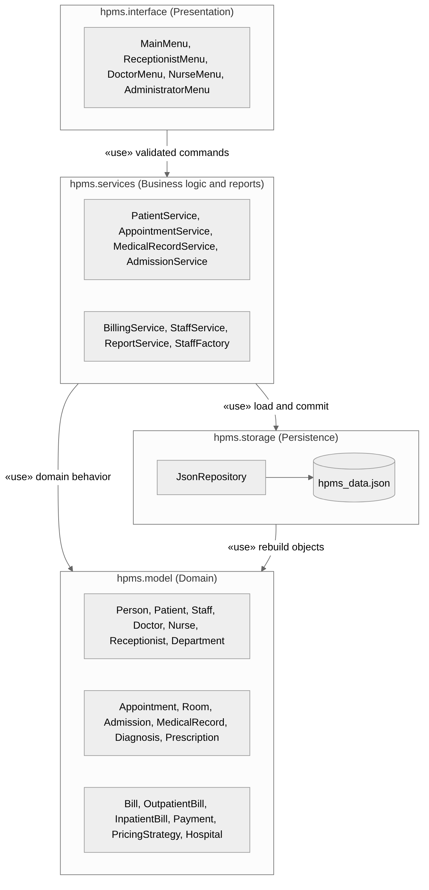

# Hospital Patient Management System (HPMS)

A menu-driven Python application that helps the staff of a small hospital or clinic manage patients, staff, appointments, medical records, inpatient admissions, rooms and billing — built to practice object-oriented analysis, design and implementation.

> Course project for **CS487 – Object-Oriented Design and Implementations**, Fall 2026, San Francisco Bay University.

---

## Table of Contents
- [Overview](#overview)
- [Core Features](#core-features)
- [Design](#design)
- [Object-Oriented Design](#object-oriented-design)
- [Tech Stack](#tech-stack)
- [Repository Structure](#repository-structure)
- [Getting Started](#getting-started)
- [Workflow](#workflow)
- [Project Milestones](#project-milestones)
- [Team](#team)

---

## Overview
Many small clinics still keep patient information on paper or in disconnected spreadsheets. Appointments get double-booked, room occupancy is tracked inconsistently and bills are calculated by hand. HPMS keeps everything in one place: it prevents scheduling conflicts, tracks room availability, organizes medical records and produces bills automatically.

The system has four user roles, chosen from the main menu (no login; Doctor and Nurse also enter their staff ID):

| Role | What they do |
|---|---|
| Receptionist | Registers patients, books/cancels/reschedules appointments, generates bills, records payments |
| Doctor | Views assigned appointments, records diagnoses, writes prescriptions |
| Nurse | Views medical history, admits and discharges inpatients, updates room status |
| Administrator | Manages staff, departments and rooms, views reports |

## Core Features
- Patient registration, search (by name or ID) and update
- Appointment booking with automatic doctor-conflict checking and free-slot suggestions
- Cancel and reschedule (a failed reschedule never changes the original)
- Medical records: diagnoses and prescriptions stamped with doctor ID and time
- Inpatient admission and discharge with room tracking (Available / Occupied / Maintenance)
- Outpatient and inpatient billing with Standard or Senior Discount pricing, and payment validation
- Reports: unpaid bills, room occupancy, daily appointments, patients by doctor
- JSON persistence — all records are saved and reloaded on restart

## Design
All design documents live in [`/docs`](docs/):

| Assignment | Document |
|---|---|
| SP1 | [Project Proposal](docs/sp1-proposal/) |
| SP2 | [Requirements Collection](docs/sp2-requirements/) — FR-01–FR-26, NFR-01–NFR-10, BR-01–BR-08, UC1–UC9 |
| SP3 | [User Stories](docs/sp3-user-stories/) — 28 stories with acceptance criteria |
| SP4 | [System Design](docs/sp4-system-design/) |
| SP5 | [UML Design](docs/sp5-uml-design/) — use-case, class, sequence, activity, state and package diagrams |
| — | [Design decisions](docs/design-decisions.md) — how open questions from instructor feedback were resolved |

## Object-Oriented Design
- **Abstraction:** abstract base classes `Person`, `Staff`, `Bill`, `PricingStrategy` (Python `abc`)
- **Inheritance:** `Person` → `Patient`, `Staff` → `Doctor`, `Nurse`, `Receptionist`; `Bill` → `OutpatientBill`, `InpatientBill`
- **Polymorphism:** `calculate_base_charge()` per bill type, `get_duties()` per staff type, `apply()` per pricing rule
- **Encapsulation:** medical records and bill balances are non-public and change only through validated methods such as `add_payment()`
- **Strategy pattern:** `Bill` delegates pricing to `StandardPricing` or `SeniorDiscountPricing`
- **Factory pattern:** `StaffFactory` creates `Doctor`, `Nurse` or `Receptionist` by role



## Tech Stack
| Layer | Choice |
|---|---|
| Language | Python 3 |
| Interface | Menu-driven command line |
| Storage | JSON files |
| Testing | pytest |
| Diagrams | Mermaid, Graphviz, draw.io |
| Version control | Git + GitHub (issues, branches, pull requests) |

## Repository Structure
```
.
├── docs/
│   ├── sp1-proposal/        # Project proposal
│   ├── sp2-requirements/    # Requirements collection
│   ├── sp3-user-stories/    # User stories and acceptance criteria
│   ├── sp4-system-design/   # System design
│   ├── sp5-uml-design/      # UML design (PDF, page, diagram sources + PNGs)
│   └── design-decisions.md  # Decision log
├── src/hpms/
│   ├── interface/           # Role menus (presentation layer)
│   ├── services/            # Business rules, StaffFactory, reports
│   ├── model/               # Domain classes and Hospital registry
│   └── storage/             # JsonRepository
├── tests/                   # pytest tests
├── .github/
│   ├── ISSUE_TEMPLATE/      # Feature, design and bug templates
│   └── pull_request_template.md
└── README.md
```

## Getting Started
### Prerequisites
- Python 3.10+
- Git

### Setup and run
```bash
git clone https://github.com/hannay-sen/Hospital-Patient-Management-System-HPMS.git
cd Hospital-Patient-Management-System-HPMS
pip install pytest
python -m src.hpms.main
```

### Run tests
```bash
pytest
```

## Workflow
1. Every task starts as an **Issue** (use the Feature, Design or Bug template).
2. Create a branch from `main`: `feature/<issue#>-short-name`, `docs/<issue#>-short-name` or `fix/<issue#>-short-name`.
3. Commit with [Conventional Commits](https://www.conventionalcommits.org/), e.g. `feat(appointments): reject double booking (#12)` or `docs(sp5): add sequence diagrams`.
4. Open a Pull Request that includes `Closes #<issue#>`.
5. At least **one teammate review** before merging into `main`.

## Project Milestones
| Milestone | Deliverable | Status |
|---|---|---|
| SP1 | Project Proposal | ✅ Submitted Sep 30, 2026 |
| SP2 | Requirements Collection | ✅ Submitted Oct 7, 2026 |
| SP3 | User Stories | ✅ Submitted Oct 17, 2026 |
| SP4 | System Design | ✅ Submitted |
| SP5 | UML Design | ✅ Submitted |
| — | Implementation, testing, final report, presentation | ⏳ In progress |

## Team
| Name | Role | GitHub |
|---|---|---|
| Sumaya Sharmin | | |
| Shreya Hada Shrestha | | |
| Ritika Khatri | | |
| Sahar Tahir | | |
| Thel Theint Theint Sen | | [@hannay-sen](https://github.com/hannay-sen) |
