# SP5 — UML Design

**Hospital Patient Management System (HPMS)**

CS487: Object-Oriented Design and Implementations

**Team Members:** Sumaya Sharmin, Shreya Hada Shrestha, Ritika Khatri, Sahar Tahir, Thel Theint Theint Sen

**Submission Date:** October 31, 2026

> 📄 PDF version: [HPMS_UML_Design.pdf](HPMS_UML_Design.pdf) · Diagram sources (Mermaid `.mmd`, Graphviz `.dot`) are in [`diagrams/`](diagrams/) next to each PNG.

## 1. Deliverables

This document contains the UML deliverables listed in Section 14 of the course UML guidance. The guide's Library examples map to HPMS as follows.

| Guide deliverable | HPMS diagram |
| --- | --- |
| Use-case diagram | UCD-01 |
| Use-case descriptions | Section 2.2 |
| Domain class diagram | CD-01 |
| Detailed class diagram | CD-02, CD-03, CD-04 |
| Issue Book sequence diagram | SD-02 Book Appointment |
| Return Book sequence diagram | SD-03 Generate Inpatient Bill and Record Payment |
| Search Book sequence diagram | SD-01 Search Patient |
| Issue Book activity diagram | AD-01 Book Appointment |
| Return Book activity diagram | AD-02 Discharge, Inpatient Billing and Payment |
| Book state diagram | STD-01 Room |
| Component or package diagram | PKG-01 |
| UML traceability table | Section 8 |

## 2. Use-case model

### 2.1 Use-case diagram (UCD-01)

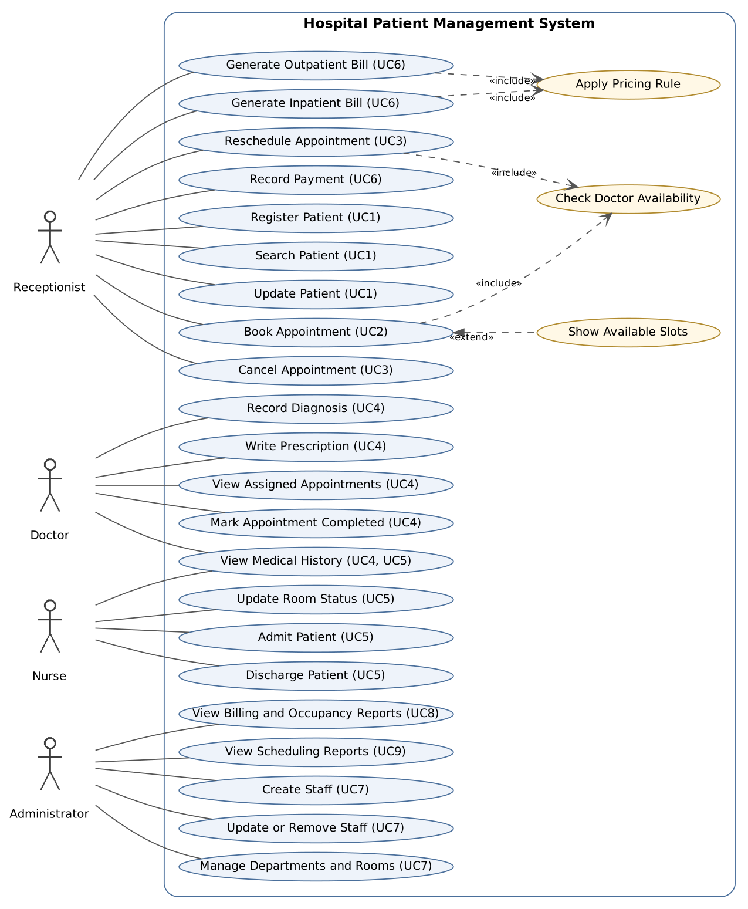

Each oval is a verb-noun goal, tagged with the requirement-level use case (UC1–UC9) it belongs to. Yellow ovals are shared behavior: *Book Appointment* and *Reschedule Appointment* always **include** *Check Doctor Availability*; both bill use cases always **include** *Apply Pricing Rule*; *Show Available Slots* **extends** *Book Appointment* only when the doctor is already booked. Save and Reload Records (FR-17) is not drawn because it is a system behavior inside every use case, not an actor goal.

### 2.2 Use-case descriptions

All use cases share these rules: the user has chosen a role from the main menu; for the Doctor and Nurse roles the CLI also asks for a staff ID and accepts it only if that staff member has the matching role (simulated identity selection, not authentication); every successful change is saved to JSON before the confirmation is shown; invalid input is rejected with a specific message and nothing is written (NFR-02, NFR-03).

**UC1 Register, Search and Update Patient** · Receptionist · FR-01, FR-02, FR-18 · US-PT-01 to 03

- **Main flow:** 1. Receptionist chooses Register Patient. 2. Enters patient ID, name, date of birth and contact. 3. System validates the fields and checks the ID is unique. 4. System creates a `Patient` with an empty `MedicalRecord`, saves, and confirms.
- **Alternatives:** 3a. Missing or invalid field → error, nothing saved. 3b. Duplicate ID → error (NFR-04). *Search:* the term matches the ID exactly or is contained in the name; no match → "No patient matches." *Update:* only name and contact can change.
- **Postcondition:** the patient exists and can be booked or admitted (BR-01).

**UC2 Book Appointment** · Receptionist · FR-04, FR-05 · US-AP-01, 02

- **Precondition:** patient and doctor are registered.
- **Main flow:** 1. Receptionist enters patient ID, doctor ID, date and hour. 2. System checks the patient and doctor exist. 3. System checks the doctor has no Scheduled appointment in that one-hour slot (includes *Check Doctor Availability*). 4. System checks the patient has no Scheduled appointment in that slot. 5. System creates the appointment as Scheduled, saves and confirms.
- **Alternatives:** 2a. Unknown patient or non-doctor ID → error. 3a. Doctor booked → reject and show that doctor's free slots for the day (extends *Show Available Slots*). 4a. Patient already booked at that hour → error.
- **Postcondition:** one Scheduled appointment links one patient and one doctor; no double booking is stored (BR-02).

**UC3 Cancel or Reschedule Appointment** · Receptionist · FR-06, FR-19 · US-AP-03, 04

- **Main flow (cancel):** 1. Receptionist enters the appointment ID. 2. System checks it exists and is Scheduled. 3. System sets it to Cancelled, saves and confirms. The slot becomes free.
- **Main flow (reschedule):** 1. Receptionist enters the appointment ID and the new date and hour. 2. System checks the doctor is free in the new slot (includes *Check Doctor Availability*). 3. System cancels the original and creates a new Scheduled appointment in one save.
- **Alternatives:** not found → error. Completed or Cancelled → "Only Scheduled appointments can be changed." New slot taken → reject and show free slots; the original stays Scheduled.

**UC4 Doctor Visits and Clinical Records** · Doctor · FR-07 to FR-10, FR-20 · US-AP-05, 06, US-MR-01 to 03

- **Precondition:** Doctor role chosen and a valid doctor staff ID entered.
- **Main flow:** 1. Doctor views own appointments (patient, time, status). 2. Doctor selects a patient and views the medical history. 3. Doctor records a diagnosis and/or writes a prescription (medication, dosage, instructions). 4. Doctor marks the appointment Completed. Each entry is saved with the doctor ID and time.
- **Alternatives:** ID not a doctor → back to main menu. Empty diagnosis or missing prescription field → error, record unchanged.
- **Postcondition:** only doctors change medical records (BR-08).

**UC5 Admit and Discharge Patient** · Nurse · FR-10, FR-11, FR-12, FR-26 · US-MR-04, US-AD-01 to 03

- **Main flow (admit):** 1. Nurse enters patient ID and room number. 2. System checks the patient is registered, is not already admitted, and the room is Available. 3. System creates an `Admission`, sets the room Occupied, saves and confirms.
- **Main flow (discharge):** 1. Nurse selects an admitted patient. 2. System closes the admission, sets the room Available, saves and confirms.
- **Alternatives:** room Occupied or under Maintenance → reject (BR-04). Patient already admitted → reject. A nurse can switch a free room between Available and Maintenance only. A nurse can view medical history but not edit it.

**UC6 Generate Bill and Record Payment** · Receptionist · FR-13 to FR-16 · US-BL-01 to 04

- **Main flow:** 1. Receptionist chooses an outpatient or inpatient bill. 2. *Outpatient:* the consultation fee (BR-06). *Inpatient:* the patient must be discharged; receptionist adds treatment charges; system computes daily rate × billable days + treatment charges, where a partial day counts as a full day (BR-05). 3. Receptionist chooses Standard or Senior pricing (includes *Apply Pricing Rule*). 4. System shows the bill and saves it as Unpaid. 5. Receptionist records a payment; the balance drops and the bill becomes Partially Paid or Paid.
- **Alternatives:** patient still admitted → "Discharge first." Senior pricing (10% off, age 65+) chosen for a younger patient → error. Payment ≤ 0 or greater than the balance → rejected, balance unchanged (BR-07).

**UC7 Manage Staff, Departments and Rooms** · Administrator · FR-03, FR-24, FR-25 · US-ST-01 to 03

- **Main flow:** 1. Administrator chooses a role (doctor, nurse, receptionist) and enters staff details. 2. `StaffService` asks `StaffFactory` for the right subclass. 3. System saves and confirms. The administrator can also add or view departments and rooms, and update or remove staff.
- **Alternatives:** duplicate ID → error (NFR-04). Removing staff who still have Scheduled appointments → rejected.

**UC8 View Billing and Occupancy Reports** · Administrator · FR-21, FR-22 · US-RP-01, 02

- **Main flow:** *Unpaid bills* lists every bill with a balance above zero (patient, bill ID, balance). *Room occupancy* lists every room with its status and current patient.
- **Alternatives:** nothing to list → suitable message.

**UC9 View Scheduling Reports** · Administrator · FR-23 · US-RP-03, 04

- **Main flow:** *Daily appointments:* administrator enters a date; system lists each appointment's time, doctor, patient and status. *Patients by doctor:* administrator enters a doctor ID; system lists patients with at least one non-cancelled appointment with that doctor.
- **Alternatives:** no results → suitable message; unknown doctor ID → error.

## 3. Class model

### 3.1 Domain class diagram (CD-01)

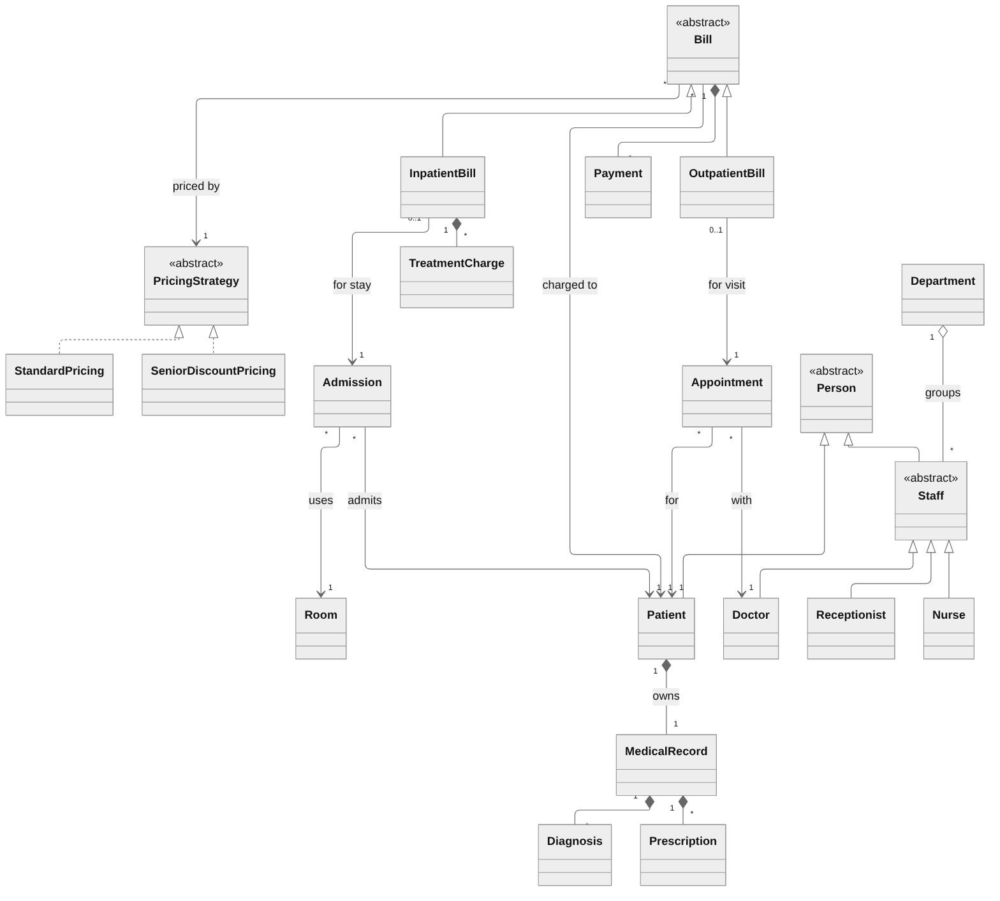

The domain view shows only concepts and how many of each take part. A patient owns exactly one medical record; an appointment links one patient and one doctor, and each may have many appointments over time; an admission links one patient and one room, with at most one active admission per patient and per room; a bill belongs to one patient, uses one pricing strategy and holds many payments.

### 3.2 Detailed class diagram: people and clinical records (CD-02)

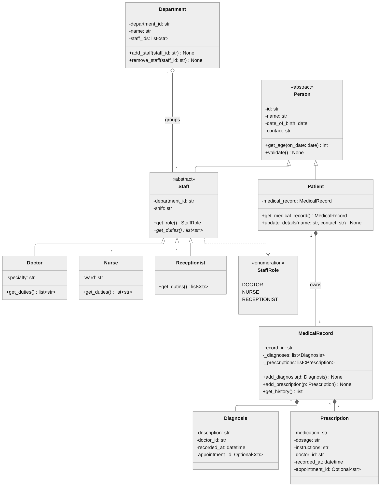

### 3.3 Detailed class diagram: scheduling, admission and billing (CD-03)

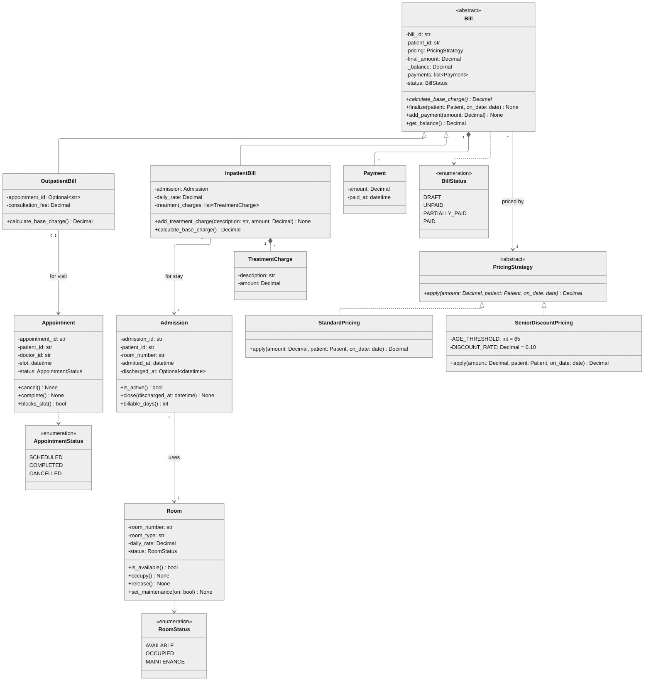

### 3.4 Detailed class diagram: application layer (CD-04)

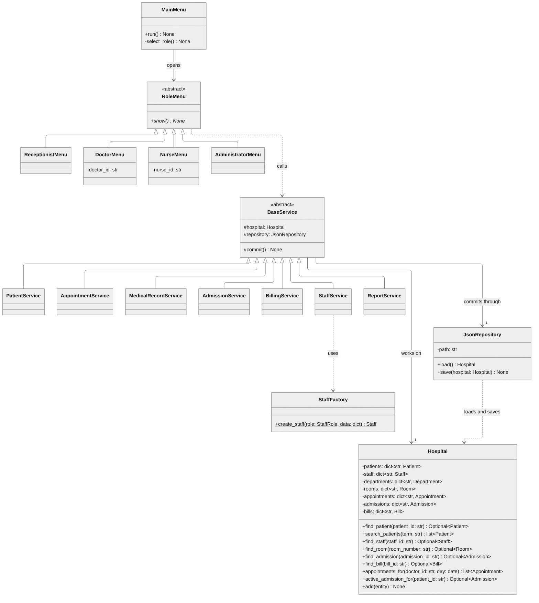

Notation: `-` private, `#` protected, `+` public; italic methods and `*` are abstract; an underlined method is static. Attributes with a leading underscore (`_diagnoses`, `_balance`) are the protected data that NFR-05 says may only change through validated methods.

## 4. Sequence diagrams

Every lifeline and message name below is a class or method from Section 3, so the sequence and class diagrams match. Failure branches are `alt` fragments; a save happens only on the success branch, so a rejected request never changes stored data.

### 4.1 SD-01 Search Patient (UC1, FR-02)

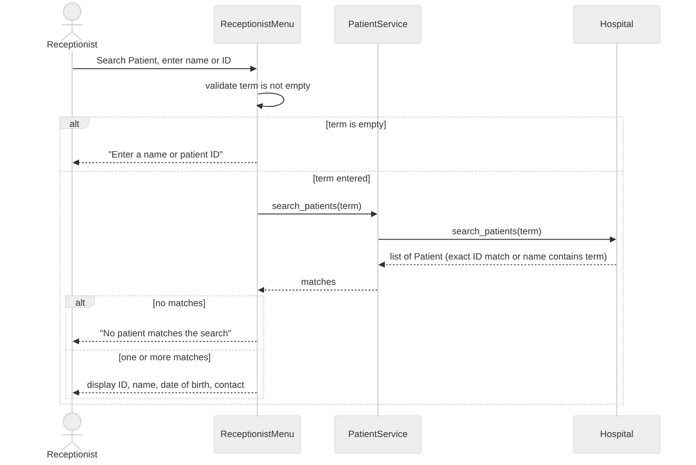

### 4.2 SD-02 Book Appointment (UC2, FR-04, FR-05)

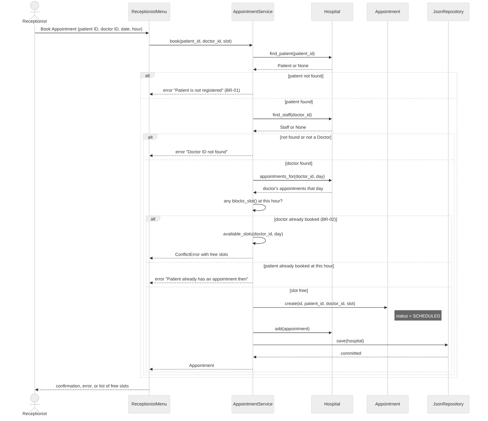

The conflict check asks each existing appointment `blocks_slot()`, which is true only for a Scheduled appointment at the same hour. On a doctor conflict the service returns the doctor's free slots instead of creating anything (BR-02).

### 4.3 SD-03 Generate Inpatient Bill and Record Payment (UC6, FR-14 to FR-16)

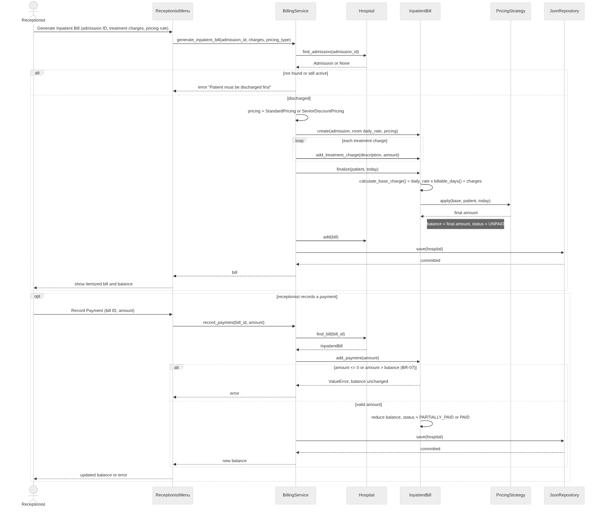

The Strategy pattern is visible here: `InpatientBill` computes its own base charge and hands it to whichever `PricingStrategy` it was given. `BillingService` never calculates money; it only finds records, creates the bill and saves. An outpatient bill follows the same path with `OutpatientBill` and no treatment-charge loop.

## 5. Activity diagrams

Each check has its own decision node and its own error, instead of one combined diamond, so every alternative flow in Section 2.2 can be traced and tested separately.

### 5.1 AD-01 Book Appointment (UC2)

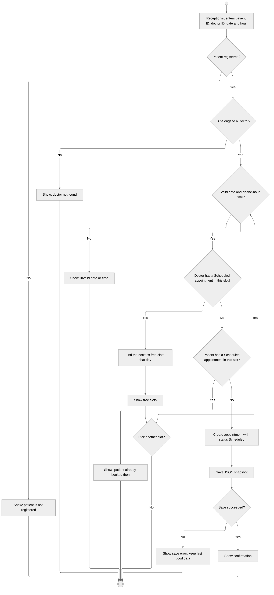

### 5.2 AD-02 Discharge, Inpatient Billing and Payment (UC5, UC6)

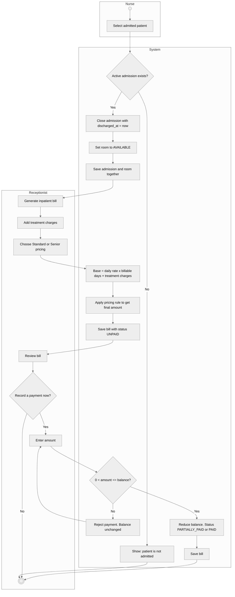

The swimlanes show the hand-off between roles: the nurse discharges, the system frees the room, and the receptionist bills. An inpatient bill can only start after discharge, so the number of billable days is known.

## 6. State diagram

The guide's Book state diagram becomes the Room lifecycle: a room is the HPMS resource that is taken and released, the way a book is borrowed and returned.

### STD-01 Room (BR-04, FR-26)

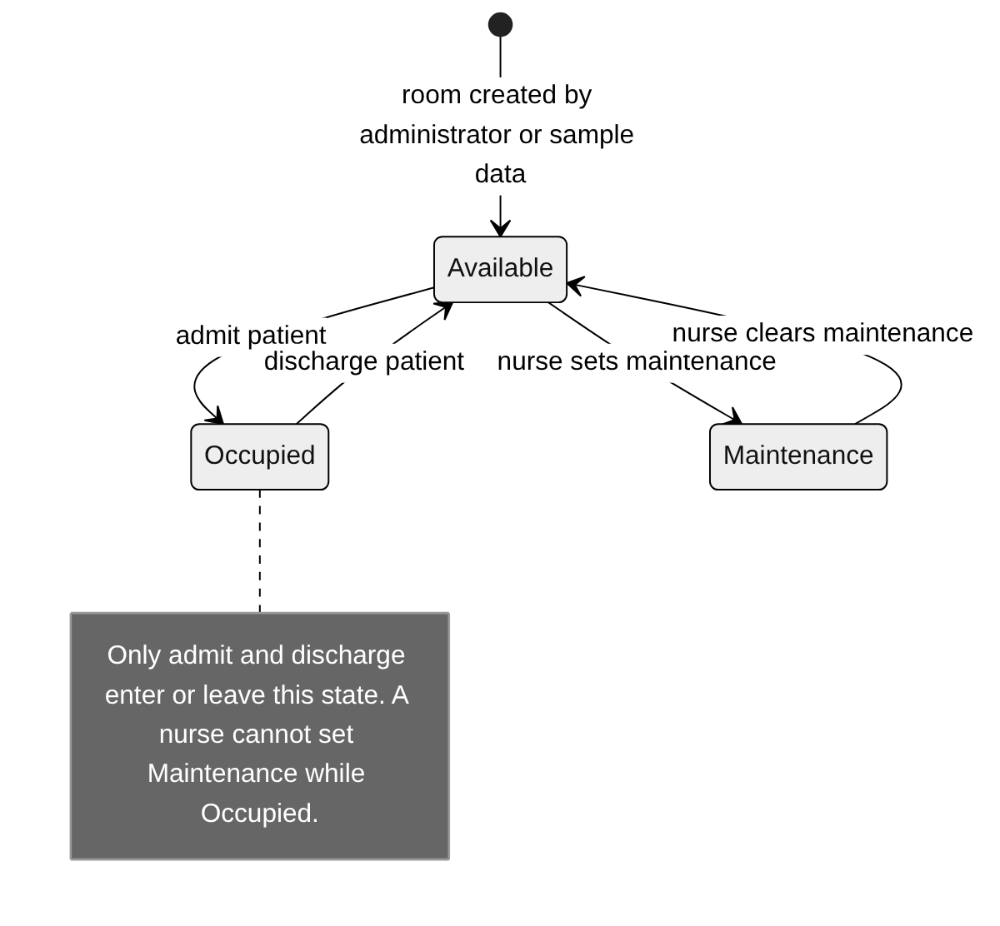

Occupancy changes only through admission and discharge. The only manual change a nurse can make is between Available and Maintenance (FR-26), so room status can never contradict a patient assignment (BR-04).

## 7. Package diagram (PKG-01)

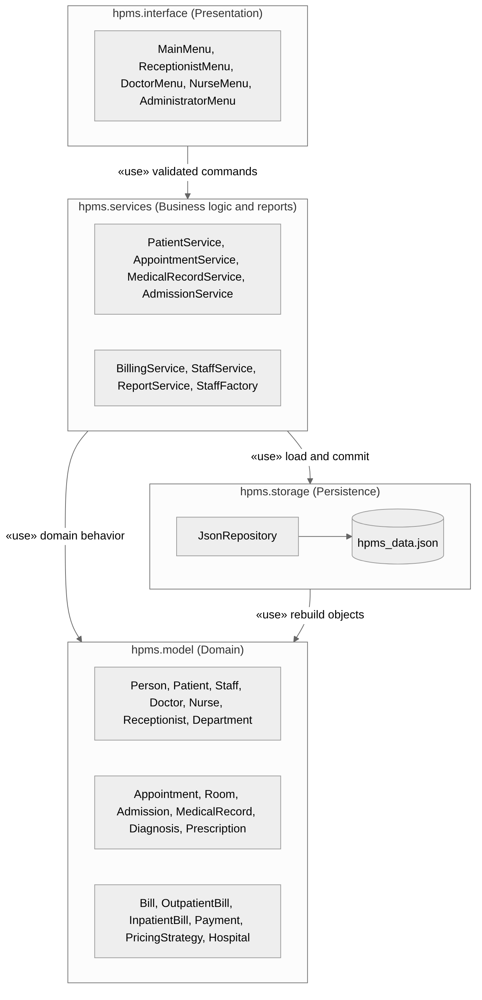

| Package | Contents | Must not |
| --- | --- | --- |
| `hpms.interface` | Role menus, input prompts, output formatting, doctor and nurse ID prompt | read or write JSON, or change domain objects directly |
| `hpms.services` | Business rules, validation, report queries, `StaffFactory`, `BaseService.commit()` | print to the console or ask for input |
| `hpms.model` | Domain classes, enums, `Hospital` registry | import from services, interface or storage |
| `hpms.storage` | `JsonRepository`: one versioned snapshot, atomic save, load-time validation | contain business rules |

Dependencies point one way only, which satisfies NFR-08: interface → services → model, and services → storage → model. Reports live in `hpms.services` as `ReportService` because they only query the `Hospital` registry.

## 8. UML traceability

Every functional requirement maps to at least one diagram and one owning class. Test IDs follow the System Design (TC-xx-nn, one per story).

| FR | Requirement | UC | Story | Diagrams | Owning class · method |
| --- | --- | --- | --- | --- | --- |
| FR-01 | Register a patient | UC1 | US-PT-01 | UCD-01, CD-01, CD-02 | `PatientService.register_patient()` |
| FR-02 | Search patients | UC1 | US-PT-02 | UCD-01, SD-01 | `Hospital.search_patients()` |
| FR-03 | Create staff by role | UC7 | US-ST-01 | UCD-01, CD-02, CD-04 | `StaffFactory.create_staff()` |
| FR-04 | Book an appointment | UC2 | US-AP-01 | UCD-01, CD-03, SD-02, AD-01 | `AppointmentService.book()` |
| FR-05 | Reject conflict, show slots | UC2 | US-AP-02 | UCD-01, SD-02, AD-01 | `Appointment.blocks_slot()`, `AppointmentService.available_slots()` |
| FR-06 | Cancel an appointment | UC3 | US-AP-03 | UCD-01, CD-03 | `Appointment.cancel()` |
| FR-07 | Doctor views appointments | UC4 | US-AP-05 | UCD-01, CD-04 | `Hospital.appointments_for()` |
| FR-08 | Record a diagnosis | UC4 | US-MR-01 | UCD-01, CD-02 | `MedicalRecord.add_diagnosis()` |
| FR-09 | Write a prescription | UC4 | US-MR-02 | UCD-01, CD-02 | `MedicalRecord.add_prescription()` |
| FR-10 | View medical history | UC4, UC5 | US-MR-03, 04 | UCD-01, CD-02 | `MedicalRecord.get_history()` |
| FR-11 | Admit to available room | UC5 | US-AD-01 | UCD-01, CD-03, STD-01 | `AdmissionService.admit()`, `Room.occupy()` |
| FR-12 | Discharge, free room | UC5 | US-AD-02 | UCD-01, AD-02, STD-01 | `Admission.close()`, `Room.release()` |
| FR-13 | Outpatient bill | UC6 | US-BL-01 | UCD-01, CD-03 | `OutpatientBill.calculate_base_charge()` |
| FR-14 | Inpatient bill | UC6 | US-BL-02 | UCD-01, CD-03, SD-03, AD-02 | `InpatientBill.calculate_base_charge()`, `Admission.billable_days()` |
| FR-15 | Apply a pricing rule | UC6 | US-BL-03 | UCD-01, CD-03, SD-03 | `PricingStrategy.apply()` |
| FR-16 | Record a payment | UC6 | US-BL-04 | UCD-01, SD-03, AD-02 | `Bill.add_payment()` |
| FR-17 | Save and reload | All | US-DS-01 | CD-04, PKG-01, SD-02, SD-03 | `JsonRepository.save()`, `load()` |
| FR-18 | Update patient | UC1 | US-PT-03 | UCD-01, CD-04 | `PatientService.update_patient()` |
| FR-19 | Reschedule | UC3 | US-AP-04 | UCD-01, CD-04 | `AppointmentService.reschedule()` |
| FR-20 | Mark Completed | UC4 | US-AP-06 | UCD-01, CD-03 | `Appointment.complete()` |
| FR-21 | Unpaid bills report | UC8 | US-RP-01 | UCD-01, CD-04 | `ReportService.unpaid_bills()` |
| FR-22 | Room occupancy report | UC8 | US-RP-02 | UCD-01, CD-04 | `ReportService.room_occupancy()` |
| FR-23 | Daily and by-doctor reports | UC9 | US-RP-03, 04 | UCD-01, CD-04 | `ReportService.daily_appointments()`, `patients_by_doctor()` |
| FR-24 | Department and room screens | UC7 | US-ST-02 | UCD-01, CD-02, CD-03 | `Department`, `Room` |
| FR-25 | Update and remove staff | UC7 | US-ST-03 | UCD-01, CD-04 | `StaffService.update_staff()`, `remove_staff()` |
| FR-26 | Nurse updates room status | UC5 | US-AD-03 | UCD-01, STD-01 | `Room.set_maintenance()` |

| Rule or NFR | Shown in |
| --- | --- |
| BR-01 registered first | SD-02, AD-01 |
| BR-02 no double booking | SD-02, AD-01 |
| BR-03 appointment statuses | CD-03 `AppointmentStatus` |
| BR-04 one patient per room | STD-01 |
| BR-05, BR-06 bill formulas | CD-03, SD-03 |
| BR-07 payment limits | SD-03, AD-02 |
| BR-08 only doctors edit records | UCD-01 |
| NFR-05 protected data | CD-02 `_diagnoses`, CD-03 `_balance` |
| NFR-06 abstract classes | CD-01 to CD-04 |
| NFR-07 Strategy and Factory | CD-03, CD-04, SD-03 |
| NFR-08 layers | CD-04, PKG-01 |
